# NeuroFlow: High-Throughput Hybrid RAG Engine with Semantic Caching & Evals

[](https://github.com/Yprnv7/neuroflow/actions)
[](LICENSE)
[](https://www.python.org/)
[](tests/)

I designed and engineered **NeuroFlow**, a modular Retrieval-Augmented Generation (RAG) backend engine focused on two major production challenges:
1. **Vocabulary Mismatch vs Semantic Drift:** Combining exact keyword matching with dense conceptual similarity.
2. **Serving Latency:** Eliminating redundant retrieval and model inference through an in-memory vectorized semantic cache.

---

## Architecture Flow

```mermaid
flowchart TD
    UserQuery["Client Query"] --> CacheStage{"Semantic Cache Check"}
    CacheStage -- "Cosine Sim >= 0.92 (Hit)" --> CachedResp["Cached Context (< 0.02ms)"]
    CacheStage -- "Miss" --> DualRetrieval["Parallel Candidate Retrieval"]

    subgraph "Retrieval Engine"
        DualRetrieval --> DenseBranch["Dense Space (Cosine Matrix Multiplication)"]
        DualRetrieval --> SparseBranch["Sparse Index (BM25 Okapi Scoring)"]
        DenseBranch --> ScoreFusion["Convex Combination: alpha * Dense + (1-alpha) * Sparse"]
        SparseBranch --> ScoreFusion
    end

    ScoreFusion --> CandidatePool["Candidate Selection (Top-K x 3)"]
    CandidatePool --> RerankStage["Cross-Encoder / Lexical Proximity Reranker"]
    RerankStage --> OutputContext["Final Ranked Chunks"]
    OutputContext --> CacheUpdate["Write to Semantic Cache (LFU Eviction)"]
    CacheUpdate --> FinalPayload["API Response (with Per-Stage Telemetry)"]
```



---

## Technical Implementation Details

### 1. Hybrid Score Fusion
Standard vector embeddings can struggle with specialized identifiers, versions, and precise lexical tokens, while BM25 fails when queries use paraphrased or conceptual language. 

I implemented a parameterized convex fusion strategy:
$$\text{Score}(q, d) = \alpha \cdot \text{DenseScore}(q, d) + (1 - \alpha) \cdot \text{NormalizedBM25}(q, d)$$
- Dense scores are normalized from $[-1, 1]$ cosine similarity to $[0, 1]$.
- BM25 scores are normalized relative to candidate maximums.
- `alpha` is configurable per request (`1.0` for pure dense, `0.0` for pure sparse, `0.6` default).

### 2. High-Speed Vectorized Semantic Cache
- Stores normalized query vectors in an active matrix.
- Uses batch matrix-vector dot products to evaluate similarity against incoming queries in sub-millisecond time.
- Employs an LFU (Least Frequently Used) with creation timestamp tiebreaker eviction policy to bound memory overhead.
- Benchmarks show **~56x speedup** on semantically equivalent queries.

### 3. Empirical Evaluation Pipeline
Rather than relying on qualitative assumptions, I implemented standard Information Retrieval metrics to evaluate retrieval performance:
- **MRR (Mean Reciprocal Rank):** Evaluates rank position of the first relevant chunk.
- **NDCG@K:** Evaluates ranked relevance with logarithmic positional discounting.
- **Precision@K & Recall@K:** Validates completeness and noise suppression.
- **MAP (Mean Average Precision):** Measures precision across all relevant ranks.

---

## Benchmark Results

Evaluated across a 500-chunk synthetic technical corpus and 100 benchmark queries:

| Metric | Result | Context |
| :--- | :--- | :--- |
| **Ingestion Throughput** | **~14,900 chunks/sec** | End-to-end embedding + inverted indexing |
| **Uncached Query P50** | **0.829 ms** | Full hybrid search + fusion + reranking |
| **Uncached Query P95** | **1.119 ms** | Tail latency across candidate pools |
| **Cached Query P50** | **0.012 ms** | **~56.1x speedup** via semantic cache hit |
| **MRR** | **1.0000** | Top rank accuracy on evaluation suite |
| **NDCG@5** | **1.0000** | Graded ranking accuracy |
| **Test Coverage** | **94%** | Across 48 unit and integration tests |

*Run benchmarks locally:*
```bash
python benchmarks/run_benchmark.py
```

---

## Project Structure

```
neuroflow/
├── neuroflow/
│   ├── api/             # FastAPI endpoints, CORS, schema validation
│   ├── cache/           # Vectorized semantic cache with LFU eviction
│   ├── config/          # Dataclass settings and environment overrides
│   ├── core/            # Pipeline orchestrator and dual-mode embedding engine
│   ├── evals/           # MRR, NDCG@K, Precision@K, MAP metrics
│   ├── models/          # Pydantic v2 schemas and enums
│   ├── retrieval/       # BM25 Okapi, Dense matrix index, Fusion, Reranker
│   └── utils/           # Logging and telemetry formatters
├── tests/
│   ├── unit/            # BM25, Dense, Cache, Metrics, Fusion test suites
│   └── integration/     # End-to-end engine and FastAPI endpoint tests
├── benchmarks/          # Latency and retrieval quality benchmark harness
├── Dockerfile           # Multi-stage production container build
├── docker-compose.yml   # Single-command local deployment
└── .github/workflows/   # Matrix CI workflow (Python 3.10, 3.11, 3.12)
```

---

## Quickstart

### Local Setup
```bash
# Clone the repository
git clone https://github.com/Yprnv7/neuroflow.git
cd neuroflow

# Install dependencies
pip install -r requirements.txt

# Start the server
uvicorn neuroflow.api.server:app --reload --port 8000
```

### Docker
```bash
docker compose up --build
```
Interactive API documentation is available at `http://localhost:8000/docs`.

### Running Tests
```bash
PYTHONPATH=. pytest tests/ --cov=neuroflow --cov-report=term-missing
```

---

## Author
**Yprnv7**  
- GitHub: [@Yprnv7](https://github.com/Yprnv7)
